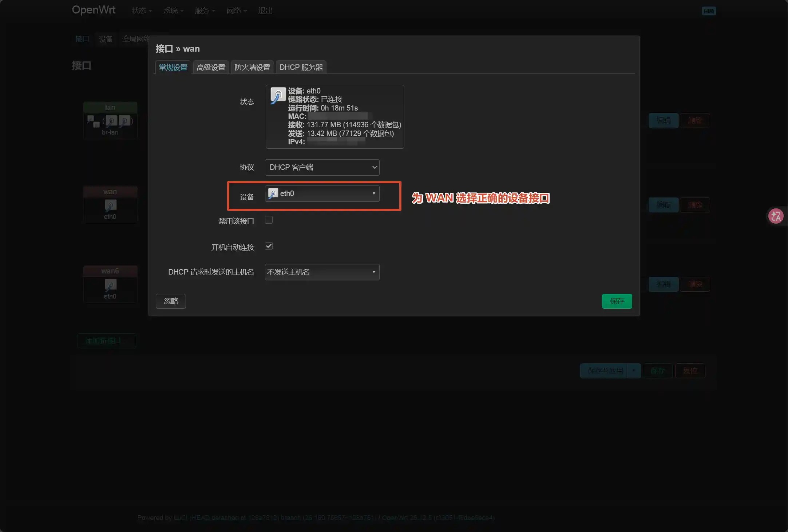
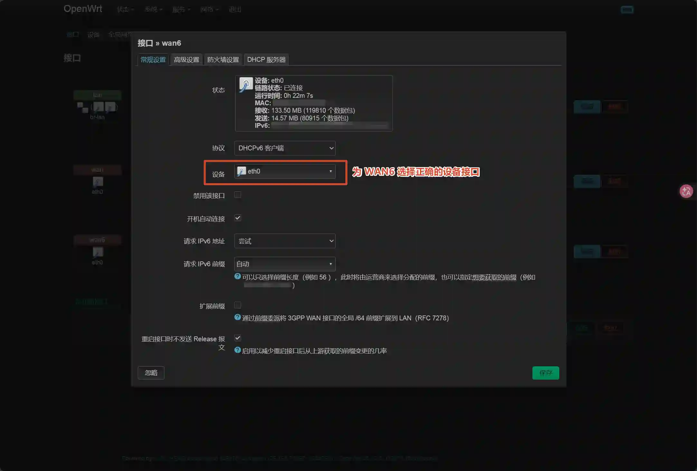
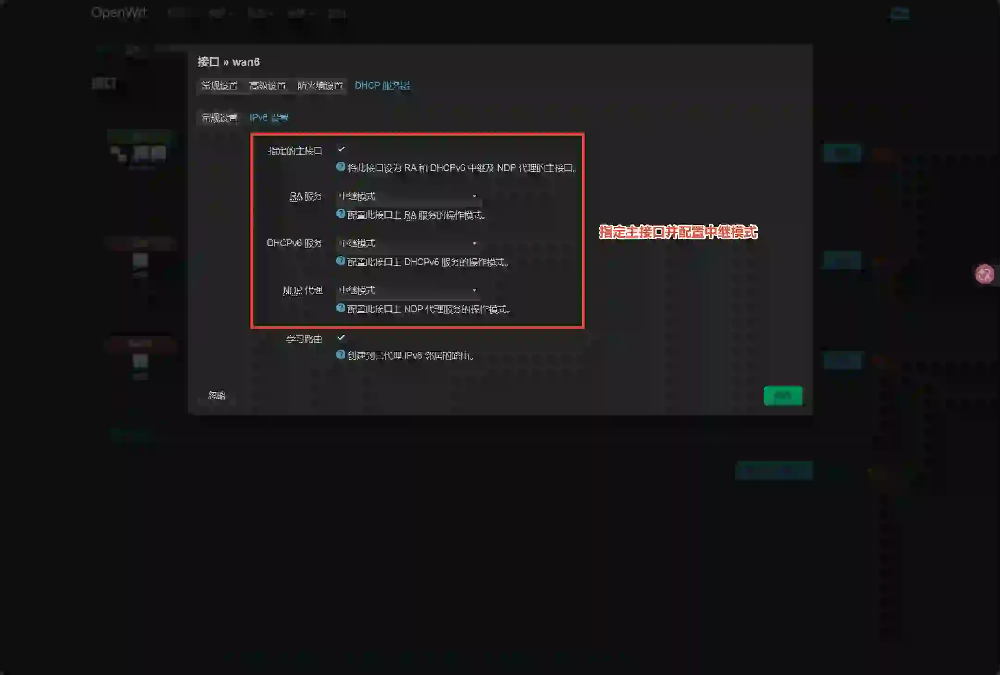
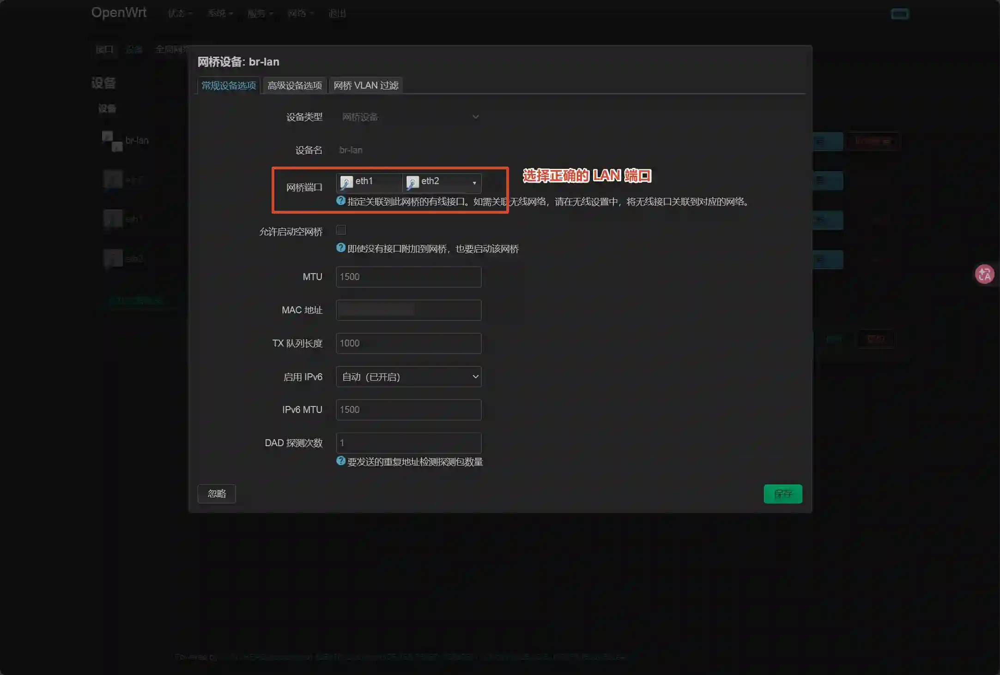

# 宿舍用网

## 准备

- 至少三根网线；
- 软路由或多网卡主机（推荐 x86_64 架构，至少满足 512MB RAM + 256MB ROM，根据实际情况选择无线网卡配置）；
- 无线路由器（可选）；
- USB 驱动器；

## 预期效果

- 个人宿舍内网搭建；
- 科学上网；
- 提供更加灵活的网络接入策略，摆脱校园网设备接入数限制；
- 使得宿舍中多设备流量出口更加合理，保证前台游戏、远程桌面延迟的同时，后台下载任务接近满速运行；
- 提供更加稳定的网络体验。

## 上手教程

### 0. 可用性检查

请先使用电脑接入有线网，检查你的宿舍是否能正常使用有线网。请参阅[个人用户有线网络接入 | 中山大学网络与信息中心](https://inc.sysu.edu.cn/service/wired-network-access)。

### 1. 资源准备

#### 1.1 固件编译

本方案采用 OpenWrt 官方固件，转至 [Releases · openwrt/openwrt](https://github.com/openwrt/openwrt/releases)，阅读仓库并为你的设备编译合适的固件。

本仓库提供了用于中山大学有线校园网的认证插件（`/minieap/`），你可以使其与固件一同编译。仓库内的插件可能仅尽力维护其在新版本上的 OpenWrt 可用性。请使用最新版固件。

> [!TIP]
>
> - 一些内核特性（例如 `kmod-tun`）必须在编译时期就启用，否则它们可能在后期无法安装；
> - 对于重要的网络设备，强烈建议你始终使用官方最新固件；
> - 本仓库的 Release 不定期提供适用于某些平台的构建产物，这些固件的构建方式如后文所述，

下面提供一个示例，用于在 Windows 上编译适用于 x86_64 的 OpenWrt v25.12.4 固件。

> 示例 WSL 环境配置为：
>
> Windows Subsystem for Linux（WSL 2）- Ubuntu Default Distribution，24 个逻辑处理器，理论可用 16094 MB 内存，可用硬盘空间为 55 GB。

1. 按照 Microsoft 官方文档，初始化 WSL 并安装 Ubuntu。检查当前科学上网工具是否处于 TUN/虚拟网卡模式，必须使 WSL 也能正常访问 GitHub。
2. 进入 WSL 环境，执行 `sudo nano /etc/apt/sources.list.d/ubuntu.sources`，随后将文件替换为以下内容并保存：

   ```text
   Types: deb
   URIs: https://mirror.sysu.edu.cn/ubuntu/
   Suites: resolute resolute-updates resolute-backports
   Components: main universe restricted multiverse
   Signed-By: /usr/share/keyrings/ubuntu-archive-keyring.gpg
   
   # 安全提示：不建议将下方的链接也更改为镜像站，镜像站同步安全更新存在延迟。
   Types: deb
   URIs: https://security.ubuntu.com/ubuntu/
   Suites: resolute-security
   Components: main universe restricted multiverse
   Signed-By: /usr/share/keyrings/ubuntu-archive-keyring.gpg
   ```

   然后执行 `sudo apt update`，等待操作完成。
3. 执行下述命令以在全新环境中完成对编译依赖的配置：

   ```bash
   sudo apt install -y bzip2 flex libz-dev make subversion unzip which build-essential clang bison gcc-multilib g++-multilib gettext libssl-dev swig 
   ```

4. 在每次会话启动后，执行 `echo $PATH`，检查返回的结果是否包含空格，请通过 `export PATH=<Your variable>` 移除那些包含空格的项目。
5. 执行 `cd`，切换到 Linux 内部文件系统的家目录，然后执行：

   ```bash
   wget https://github.com/openwrt/openwrt/archive/refs/tags/v25.12.4.tar.gz
   ```

   链接因当前版本而不同，请前往 OpenWrt 仓库的 Release 页面获取最新链接。

   然后执行 `tar xvf v25.12.4.tar.gz` 以解压该压缩包。随后执行 `cd openwrt-25.12.4`。

6. 执行 `nano feeds.conf.default`，在文件末尾添加以下内容并保存：

   ```text
   src-git sysu https://github.com/sysu/Stu-Network.git;main
   ```

7. 依次执行 `./scripts/feeds update -a`，`./scripts/feeds install -a`，等待操作完成。

8. 执行 `make menuconfig`，在接下来的页面完成下述设置：

   勾选：通常是指通过选中项目以后，按下空格键使得对应项目前的勾选状态变为星号 <*>。

   1. 在 `Target System` 和 `Subtarget` 中选择适合你设备的架构；
   2. 前往 `LuCI`：
      1. 前往 `1.Collections`，勾选 `luci`；
      2. 前往 `2.Modules`：
         1. 勾选 `luci-compat`；
         2. 前往 `Translations`，勾选 `Simplified Chinese (zh_Hans)`；
   3. 前往 `Base system`：
      1. 取消勾选 `dnsmasq`，勾选 `dnsmasq-full`；  
   4. 前往 `Utilities`：
      1. 前往 `Shells`，勾选 `bash`；
      2. 前往 `Compression`，勾选 `unzip`；
   5. 前往 `Network`：
      1. 勾选 `ipset` 和 `sysu-auth`；
      2. 前往 `File Transfer`，勾选 `curl`；
      3. 前往 `Routing and Redirection`，勾选 `ip-full`；
   6. 前往 `Languages`，前往 `Ruby`，勾选 `ruby`，`ruby-yaml`；
   7. 前往 `Kernel modules`：
      1. 前往 `Network Support`，勾选 `kmod-tun`， `kmod-inet-diag`；
      2. 前往 `Netfilter Extensions`，勾选 `kmod-nft-tproxy`；

   然后，Exit and Save。

9. 执行 `make download`，等待操作完成。

10. 执行 `vi package/feeds/packages/rust/Makefile`，将第 79 行 `set=llvm.download-ci-llvm` 设置为 `false`。

11. 执行 `make -j N`，其中 N 的值请遵循下述约束使用尽可能大的值，值越大编译速度越快：

    1. N 的值不能超过当前 Linux 当前可用核心数 + 1；
    2. N 的值越大，编译过程中占用的 RAM 越大，如果设置的 N 太大导致超过最大 RAM 限制使得编译进程被杀死，你必须重启 WSL 环境，然后重新定位到工作目录，执行 `make -j N`，尝试调小 N 的值；
    3. 有时你可能遇到一些错误。如果你按照上述指引操作，编译错误的概率应该会大大降低，如果你需要定位具体错误以寻求相关帮助，请给 `make` 命令添加 `V=s` 选项；
    4. 参考：对于示例环境，N = 18 是恰到好处的充分利用资源的设置，你应该关闭 Windows 上运行的绝大多数程序以给 WSL 预留足够的资源。

12. 编译好的产物存放在 `./bin/targets/`。

### 2. 软路由配置

#### 2.1 软路由刷机

请按照 OpenWrt 官方指引，将固件以恰当的方式刷入你的设备。

> 对于 x86_64 设备，如遇到文件系统错误导致调整 rootfs 分区大小操作失败，请按以下方法处理。
>
> 重启至 Ubuntu LiveCD，执行终端：
>
> ```bash
> lsblk -f
> ```
>
> 可能得到：
>
> ```bash
> sda
> ├─sda1  vfat
> └─sda2  ext4
> ```
>
> 例如此处的 `/dev/sda2` 即是需要扩容的 rootfs 分区，请检查该分区是否被挂载：
>
> ```bash
> mount | grep sda
> ```
>
> 若 `/dev/sda2` 已挂载，请执行卸载：
>
> ```bash
> sudo umount -l /dev/sda
> ```
>
> 接下来请按顺序执行下述命令：
>
> ```bash
> sudo e2fsck -f -y /dev/sda2
> sudo resize2fs -f /dev/sda2
> sudo e2fsck -f -y /dev/sda2
> sudo parted /dev/sda
> (parted) print
> ```
>
> 执行到此处时，若询问 `Fix/Ignored` ，输出 `F` 回车确认，记住 `/dev/sda2` 的 `number`（这里是 `2`），然后继续执行：
>
> ```bash
> (parted) resizepart 2 100%
> (parted) quit
> sudo resize2fs -f /dev/sda2
> sudo e2fsck -f -y /dev/sda2
> ```
>
> 如果最后没有报错，或得到 harmless 的结果，则执行 `sudo reboot` 以启动 OpenWrt。

#### 2.2 网口配置

启动 OpenWrt 以完成网口配置。以具有三网口（eth0 作为 WAN，eth1 和 eth2 作为 LAN）软路由为例：

- 选择合适的 LAN 口与电脑连接，确保电脑可获取到类似 `192.168.1.*` 的 IPv4 地址；
- 电脑 Web 访问 `192.168.1.1` --> **Log in**（无密码） --> 按照提示设置密码后重新登录；
- 转至 [OpenWrt | 接口](http://192.168.1.1/cgi-bin/luci/admin/network/network)，确认当前连接的端口，然后按以下截图配置：





  切换到设备选项卡，然后配置 br-lan，如图所示：



- （可选）将电脑与无线路由器 LAN 相连，无线路由器 WAN 与软路由 LAN 相连，将无线路由器改为有线中继模式。

#### 2.3 配置认证

- 转至 Web 页面的【服务】-【SYSU 认证】，填入 NetID 账号和密码并启用，以完成校园网认证配置。

#### 2.4 OpenClash 配置

- 转到 [vernesong/OpenClash](https://github.com/vernesong/OpenClash)，按照 Wiki 等相关指引完成适合你的科学上网配置。

#### 3.6 Tailscale 配置

Tailscale 通过点对点 NAT 穿透让内网设备无需公网 IP 即可直连，并支持将某台设备设为 Exit Node 来统一加密路由全部公网流量。下述介绍了将你的软路由配置为 Tailscale 网络中的 Exit Node 的方法。

- 转至 [Tailscale Packages - stable track](https://pkgs.tailscale.com/stable/)，复制适合你的平台架构的二进制文件链接；

- 用 `wget` 获取文件直链，然后按如下解压：

  ```bash
  opkg update
  opkg update tar
  tar xvf tailscale_VERSION_ARCH.tgz
  ```

- 把可执行文件移到 `sbin` 里，如下：

  ```bash
  cp tailscale_VERSION_ARCH/tailscale /usr/sbin/
  cp tailscale_VERSION_ARCH/tailscaled /usr/sbin/
  chmod +x /usr/sbin/tailscale*
  ```

- 写守护脚本 `/etc/init.d/tailscale`

  ```bash
  #!/bin/sh /etc/rc.common
  START=99
  USE_PROCD=1
  start_service() {
      mkdir -p /var/run/tailscale
      procd_open_instance
      procd_set_param command /usr/sbin/tailscaled \
          --state=/etc/tailscale/tailscaled.state \
          --socket=/var/run/tailscale/tailscaled.sock
      procd_set_param respawn
      procd_close_instance
  }
  ```

- 调用启动

  ```bash
  /etc/init.d/tailscale enable
  /etc/init.d/tailscale start
  ```

- 执行 `tailscale up`，然后在浏览器验证令牌

- 在 Interface 部分给硬件 `tailscale0` 建一个 `tailscale0` 的 interface，不需要任何 Manage。

- 在 Firewall 部分给这个 Interface 建一个 Zone，策略为输入 Drop，输出 Accept，区域内转发 Accpet。

## 结语

进入 SYSU 后，发现前人给到的资源太过松散，于是折腾了一些时间，做一个通用的一站式方案出来，希望能帮到你。

如果你还有灵感，请在 Issue 中告诉我。

## 相关说明 Illustration

你应当遵循该仓库包含的其它文件的所有开源协议。特别感谢他们对开源社区的贡献。

如果上述内容侵犯了您的相关权益，您可以通过邮件联系我删除。

由于 Pull Request 之前发生过潜在的隐私泄露风险，Pull Request 的不可删除特性，为了保护我的隐私，已阻止对 Pull Request 的访问。如果您希望贡献仓库，请将修改完成的文件上传到 Issue，谢谢！

> 推荐
>
> [RenAhsAcme/edunet-openwrt](https://github.com/RenAhsAcme/edunet-openwrt)
